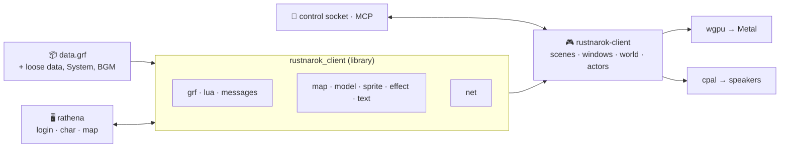

<div align="center">


# rustnarok-client

**A native Ragnarok Online client for macOS, written from scratch in Rust. It builds on Linux and Windows too.**

The windows, fonts, sounds and behavior of the official client, drawn from the player's own game data at runtime.
As good as the original, and better where it can be.

[](rust-toolchain.toml)
[](#-quick-start)
[](https://wgpu.rs)
[](#-server)
[](https://github.com/kindraywind/rathena/tree/rustnarok)
[](#-status)
[](#-conventions)

[Quick start](#-quick-start) · [What works](#-what-works) · [An AI plays it](#-an-ai-plays-it) · [Server](#-server) · [Development](#-development) · [Not done yet](#-not-done-yet)

</div>

## 🧭 Status

> [!WARNING]
> **Alpha, in early development.** Expect bugs, and features that don't yet behave like the official client's; there
> is more to fix and align. Contributions are welcome: open an [issue](https://github.com/kindraywind/rustnarok-client/issues)
> or a pull request, following the [conventions](#-conventions).
>
> This is a learning project: a study of how a game client is built, not a product.

---

<table>
<tr>
<td width="50%" valign="top">

### 🦀 Rust all the way down
wgpu for the picture, cpal for the sound, an embedded Lua 5.1 for the client's data tables. No official client code,
no wrapper.

</td>
<td width="50%" valign="top">

### 📦 The player's own game data
GRF archives, GND/GAT/RSW maps, RSM models, SPR/ACT sprites and STR effects, read at runtime. Nothing from the game
ships in this repository.

</td>
</tr>
<tr>
<td width="50%" valign="top">

### 📡 The real protocol
Login, char and map servers at PACKETVER 20220406. Every packet length is generated from the server's own headers.

</td>
<td width="50%" valign="top">

### 🧪 Tested by playing
A control socket and an [MCP server](#-driving-the-client) drive the live client; scenario suites screenshot each change and diff it
against `main`.

</td>
</tr>
</table>

## ✨ What works

| Area | What's there |
|---|---|
| 🔐 **Login to map** | The 2018+ login window (saved ID), server select, character select with sprites and the 4-digit PIN pad, moving and renaming characters, character creation (doram included) and deletion with its birthdate check, the loading screen. |
| 🌍 **The world** | GND ground with lightmaps, RSW models (RSM 1.x), water, GAT walkability, weather (snow, cherry blossoms, leaves, clouds, fog, fireworks), the camera (right drag turns, wheel zooms), cursors, the minimap with NPC marks and party members, the world map. |
| 🧙 **Characters** | Players with heads, headgear, weapons, shields and garments; monsters, NPCs, pets and warp portals; walking, sitting, emotions, spirit spheres and coins, pushcarts; HP/SP bars, names with party, guild, position and emblem on pointing, chat bubbles, cast bars, the MVP banner. |
| ⚔️ **Combat and skills** | Attacking with reach checks, damage numbers of every kind, death; the skill window and hotkeys, casting with targets, status icons, effects (STR animations, moving textures and sprites, cylinders, sprite animations, camera shakes), skills' units on the ground (Fire Wall, Safety Wall, Pneuma, warp portals, traps), Warp Portal's destination list, Auto Spell and Shadow Spell. |
| 🪟 **Windows** | Basic info with its menu, inventory (with expansion), equipment (and another player's), item descriptions with card slots, status (raising stats), skills, the hotkey bar, chat with whispers, the emotion list and chat macros, NPC dialogs (menus, number and text input), quests, the option menu (Esc) with audio, graphics and shortcut settings, the right-click menu. |
| 🛒 **Trade and crafting** | NPC shops, markets and barter shops, trading, vending (one's own shop and others'), buying stores (one's own store and selling into others'), storage, cart, the bank, the refine window, the enchant window, the grade enchant window, card insertion, the Magnifier, making items from a list (Pharmacy, Arrow Crafting, cooking), Repair and Upgrade Weapon, the material window (Change Material, Four Spirit Analysis). |
| 🐾 **Pets** | Taming with its slot machine, hatching, the pet window (Alt+J), feeding, renaming, accessories, performances and pet talk. |
| 🧪 **Homunculus** | Its sprite, the window (Alt+R) with its values, bars and words, the skill list with level up, feeding, renaming, following the player (Alt+T) and Alt + right click orders. |
| 👥 **Together** | Parties, guilds (info with the emblem, members, positions, skills, expel list, notice), clans, friends, chat rooms, RODEX mail, server announcements and item news. |
| 🔊 **Sound** | Each map's music, NPC scripts' sounds and music, sprites' own sounds (attacks, flinches, deaths), effect sounds, volume settings. |
| 🍎 **macOS** | Retina-sharp text, a resizable window, fullscreen (Ctrl+Cmd+F; Alt+Enter on Linux and Windows), an `.app` bundle. |
| 🌐 **English** | Through a translation pack's loose files placed over data.grf, as the official client does. |

Window places are measured over the client's own bitmaps where they show them. Where they don't, they are estimates
marked `ponytail:` in the code, to calibrate against screenshots of the real client.

## 🤖 An AI plays it

`rustnarok-client-mcp` hands the client to an AI assistant such as Claude Code. Ask in plain words: it looks at the
screen, reads the game state and plays through the client's own mouse and keyboard handling.

> **"Reset my skills with a Neuralizer and rebuild me for the War of Emperium."**

```text
state                     → a Wizard, job level 50
key Alt+Q, double click   → its gear off: the Neuralizer wants nothing carried
click (the Kafra's box)   → the Kafra's menu, then her storage
drag × n                  → everything but the Neuralizer into storage
key Alt+E, double click   → the Neuralizer: every skill point back
key Alt+S, state          → the skill tree, each skill's box
click × n                 → Storm Gust, Quagmire, Safety Wall, Jupitel Thunder ...
drag × n, double click    → the gear out of storage and on again
drag × 4                  → the war skills onto F1-F4
```

> **"Take my Novice through the Acolyte job change."**

```text
state                    → a Novice, job level 10, in Prontera
click (the priest's box) → the dialog, as text: the NPC's lines, Next, a menu
click, key Enter × n     → reads each line, picks the Acolyte choice
state                    → the priest sends it to a pilgrim outside the town
click × n                → walks the fields to the pilgrim, talks, walks back
state                    → job: Acolyte
```

NPC dialogs come as text, menus as lists to pick from, so quests that are talking, walking and fetching suit it best.

More errands to hand over:

| Ask | What it does |
|---|---|
| 🛒 *"Buy 50 Red Potions and put them on F1."* | Walks to the tool dealer, buys them and drags them onto the hotkey bar. |
| 💇 *"Try every hair color and show me."* | Clicks through the stylist's colors and sends a screenshot of each to pick from. |
| 📸 *"A photo of me casting Storm Gust by the Prontera fountain."* | Pauses the clock at the effect's best frame, turns the camera and crops the shot. |
| 🗣️ *"Talk to this NPC and tell me what it says in Thai."* | Reads the dialog, translates it and picks the option you choose. |
| 🧙 *"Make me a new character for an archer build."* | Creates and names it, then spends its stat points on AGI and DEX. |
| 💬 *"I'm off to eat. Answer whispers and tell me who wrote."* | Waits for chat, replies, and sums it up when you're back. |
| 🎉 *"Run a 10-question quiz in chat and give the winner an Old Blue Box."* | Asks, reads the answers, hands out the prize with a GM command: a game master for a server among friends. |
| ♿ *"Walk to Prontera and sell my loot."* | Plays by typed or spoken words, for players who find the mouse hard. |

It takes a few seconds a step, and a driven client ignores the real mouse and keyboard, so it runs errands rather
than fights beside you. Use it on your own server: a bot on someone else's breaks its rules.

Setting it up: [Driving the client](#-driving-the-client).

## 🚀 Quick start

1. **Rust**: install rustup; `rust-toolchain.toml` pins the nightly the code builds with. Also, by OS:
   - **macOS**: the Xcode command line tools (`xcode-select --install`). Text is Tahoma, with AppleGothic for Hangul.
   - **Linux**: a C compiler, ALSA headers and pkg-config (`sudo apt install build-essential libasound2-dev
     pkg-config`; `alsa-lib-devel` on Fedora), and Vulkan or OpenGL drivers. Text is fontconfig's pick for Tahoma and
     for Korean (`fonts-nanum`, say).
   - **Windows**: Visual Studio's C++ build tools (MSVC) and DirectX 12 or Vulkan. Text is Tahoma, with Malgun Gothic
     for Hangul.

   Settings (saved ID, sound, chat macros) are kept in `~/Library/Application Support/rustnarok-client` on macOS,
   `%APPDATA%\rustnarok-client` on Windows and `~/.config/rustnarok-client` (or `$XDG_CONFIG_HOME`) on Linux. CI
   builds, tests and lints on Linux; Windows was last checked by CI in PR #128.
2. **Game data**: put an official kRO `data.grf` (2024 data is what's tested) in the repository folder, or point
   `RUSTNAROK_CLIENT_GRF` at one.
3. **English** (optional): a translation pack's `data` and `System` folders next to data.grf. Their loose files go
   before the archive. `RUSTNAROK_CLIENT_DATA=<folder>` says where they are; `none` turns them off.
4. **Music** (optional): the official `BGM` folder (numbered mp3s) next to data.grf, or `RUSTNAROK_CLIENT_BGM=<folder>`.
5. **A server**: see [Server](#-server).

Then build and play:

```bash
cargo run --release
```

`tools/bundle.sh` builds `Ragnarok.app`. Like the official client, the app goes next to data.grf (and the data,
System and BGM folders). Started from Finder, it works in its own folder.

`data.grf`, `data`, `System`, `SystemEN` and `BGM` are gitignored. In development they are symlinks to wherever the
files live.

## 🏰 Server

As the official client does, it reads the server list from `data/clientinfo.xml` (else `sclientinfo.xml`) in the
data folder. Only a loose file counts, never the copy inside data.grf. With several connections, a list to pick from
comes before the login window, and each connection's `<version>` and `<loading>` pictures are used. Without the file
it logs into `127.0.0.1:6900`; `RUSTNAROK_CLIENT_SERVER=host:port` overrides both. To join a server on another
machine, put its address in clientinfo.xml; the server must announce an address the player can reach.

The server must run PACKETVER 20220406 without packet obfuscation. The rathena this client is developed against is a
fork with those settings and a setup guide for macOS: [kindraywind/rathena](https://github.com/kindraywind/rathena)
(branch `rustnarok`, see its RUSTNAROK.md). Its changes from upstream:

- `src/custom/defines_pre.hpp`: `#define PACKETVER 20220406`.
- `src/config/packets.hpp`: packet obfuscation off.
- `conf/import-tmpl/char_conf.txt`: `pincode_enabled: no`; `conf/import-tmpl/login_conf.txt`: `new_account: yes`.

Test accounts live in that server's database; their passwords never go in this repository. Keep them in a file
outside it with `username:`/`password:` lines (`username2:`/`password2:` and so on for more), which the dev tools
read.

## 🔧 Development



<details>
<summary><b>Layout</b></summary>

The library (`src/lib.rs`) holds what doesn't draw: `grf` (archives, with the mixcrypt decryption), `lua` (the
client's Lua tables run in a sandboxed Lua 5.1: item, skill, job, look, pet and world-map data), `net`
(login, char and map server protocols, every packet the client reads or sends), `map` (GND, GAT, RSW), `model` (RSM),
`sprite` (SPR, ACT), `effect` (STR), `text` (font rasterizing), `messages` (msgstringtable and its `%s`/`%d` filling).

The binary (`src/main.rs` and its modules) is the game: `render` (wgpu: sprites, text, the canvas viewport), `world`
(the 3D world pass and camera), `actor` (units, their animation and sounds), `effects` (the effect player and its
table `effects.txt`), `sound` (music and effects over cpal), `control` (the test-driver socket), and one module per
window, from `basic_info`, `inventory` and `buying` to `pet`, `pin`, `refine` and `worldmap`.

`main.rs` holds the scenes (login, character select, game), the game state, input, the server's events and
drawing. The UI draws in a fixed 1024×768 canvas, scaled to the window.

</details>

<details>
<summary><b>Packet lengths</b></summary>

An unknown packet ID ends the connection, so the client knows every packet length the server uses:
`src/packet_lengths.txt`, generated from rathena's headers by `tools/packet-lengths/run.sh <rathena> <output>`. It
compiles the server's packet tables and structs at this PACKETVER, and finds the packets rathena writes by hand.
Regenerate it whenever the server changes.

</details>

### Tests

```bash
cargo test --release
```

Some tests read the official data.grf (`RUSTNAROK_CLIENT_GRF`, or `./data.grf`) and skip themselves without it, as on
CI. One test logs into a running server
and is ignored by default; it runs with `RUSTNAROK_CLIENT_TEST_ACCOUNT=user:password cargo test -- --ignored`.

`.claude/skills/rustnarok-dev/` is the shared develop-and-verify loop: `verify.sh` (fmt, clippy, tests, a live
login), and `visual.py`, which plays the JSON scenarios in `scenarios/` on this tree and on `main` and writes
before/after/diff sheets of every screenshot.

### 🤖 Driving the client

- `RUSTNAROK_CLIENT_CONTROL=<socket>` lets a test driver play the client over a Unix socket (on Windows, a localhost
  port that file names, with a token to open with): screenshots, clicks, keys,
  typing, the game state with units' screen boxes and named click targets, waiting for packets,
  pausing the clock. The commands are listed at the top of `src/control.rs`. A driven client ignores the real mouse
  and keyboard and stays silent.
- `src/bin/rustnarok-client-mcp.rs` offers those commands as MCP tools, so an AI assistant can launch and play the
  client (`claude mcp add rustnarok-client-dev -- <repo>/target/release/rustnarok-client-mcp`).
- `RUSTNAROK_CLIENT_SCREENSHOT=out.png` renders headlessly, saves a settled frame and quits; in the game after
  `RUSTNAROK_CLIENT_SHOT_DELAY` seconds.
- `RUSTNAROK_CLIENT_TRACE=1` prints received packets; `=full` dumps them whole.

<details>
<summary><b>More dev switches and tools</b></summary>

The top of `src/main.rs` lists the other dev switches: logging in and picking a slot (`RUSTNAROK_CLIENT_LOGIN`,
`RUSTNAROK_CLIENT_AUTOSTART`), entering a PIN (`RUSTNAROK_CLIENT_PIN`), scripted chat and GM commands
(`RUSTNAROK_CLIENT_SAY`), clicks (`RUSTNAROK_CLIENT_CLICKS`), walking, talking, fighting, shops, storage, trades,
parties, guilds and more.

The examples are tools for reading the game data: `grf_list`, `grf_extract`, `grf_grep`, `grf_sheet` (images to one
PNG), `lua_dump`, `messages`, `job_name`, `act_sounds`, `str_dump`, `map_info`, `rsm_versions`, `map_probe`.

</details>

### 📐 Conventions

- **Clean room**: no decompiled code from the official client. The protocol comes from the server's source, file
  formats from public documentation, and the client's look from its own data files.
- **No game data in git**: no .grf, nothing extracted from one, no screenshots. Fact tables written by hand
  (`effects.txt`, `status_icons.txt`, `packet_lengths.txt`) are code.
- **`ponytail:` comments** mark deliberate shortcuts and estimates, with what would replace them.
- `cargo fmt` (`rustfmt.toml`, 160 columns) and `cargo clippy` stay clean.
- The crate and binary are `rustnarok-client` (the library `rustnarok_client`); dev switches start with
  `RUSTNAROK_CLIENT_`.

## 🚧 Not done yet

- [ ] Calibrating window places against screenshots of the real client.
- [ ] Effects the client draws in code other than camera shakes and weather (auras, body flashes, songs), stone spikes
  (Earth Spike, Heaven's Drive), missiles flying from the caster (Soul Strike, Fire Ball).
- [ ] Guild management: editing positions, expelling, registering an emblem, alliances; the status window's trait stats.
- [ ] World map: dungeons, monster info, the other worlds. Quests: the recommended tab.
- [ ] Mail: returning mail, selecting several; the fee shown before sending.
- [ ] Weapon hit sounds; RSM2 models; lightmap edge smoothing.

## 📜 Licenses

See [THIRD_PARTY_NOTICES.md](THIRD_PARTY_NOTICES.md) for the code in `src/grf/mixcrypt.rs` that comes from elsewhere.

---

<div align="center">
<sub>Ragnarok Online is a trademark of Gravity Co., Ltd. This project is not affiliated with or endorsed by Gravity,
and it ships no game data: the client reads the player's own files.</sub>
</div>
